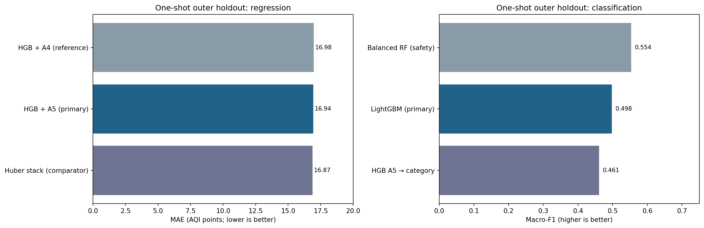

# PM2.5 AQI Estimation and Severity Classification

**Reproducible machine-learning research code for numerical PM2.5 AQI estimation and six-class air-quality severity classification using three gaseous AQI values and Country.**

The project contains a frozen internal-holdout evaluation, a transparent selection protocol, development-only grouped model comparisons and dedicated leakage tests. This is a **cross-sectional estimation** study, **not** future-time forecasting, independent external validation or causal inference.

## Key recorded results

| Task | Primary fixed model | Internal holdout (4,707 rows) | Fixed comparator |
|---|---|---:|---|
| Numerical AQI | log-HGB + A5 | **MAE 16.937** | Huber stack MAE 16.872 |
| Six-class severity | LightGBM + A4 | **macro-F1 0.4977** | Balanced RF macro-F1 0.5537 |

Comparator scores are **reported, not used to retroactively change** prespecified primary models. Differences in regression MAE are small; geographic transfer remains uncertain. Read [full results](docs/RESULTS.md) and [methodology](docs/METHODS.md).



## Quick start — without Kaggle credentials or a dataset

```bash
python -m pip install -r requirements.txt
python scripts/verify_release.py
python -m pytest -q -m "not slow and not requires_data"
python -m notebook
```

Open **`PM2.5_Research.ipynb`** and use **Run All** to view/verify published tables and figures. **This does not retrain a model and does not score the final holdout.** On GitHub, notebook outputs can be viewed directly without Jupyter.

## Rerun development training (requires the original data)

The raw dataset is **not bundled in this public-upload package**. See [data acquisition and licensing](data/README.md). After a lawful download, the script installs a verified copy at the expected local path:

```bash
python scripts/download_data.py
python -m pytest -q -m "not slow"
python scripts/reproduce_development.py --mode screening
python scripts/reproduce_development.py --mode stacking
```

On Windows PowerShell, you can run `./setup_windows.ps1 -OpenNotebook` for one-step installation, integrity checks and Jupyter. Or use the manual commands below:

```powershell
py -3.11 -m venv .venv
.\.venv\Scripts\python.exe -m pip install -r requirements.txt
.\.venv\Scripts\python.exe scripts\verify_release.py
.\.venv\Scripts\python.exe -m notebook
```

These commands can be computationally expensive; see [reproducibility](docs/REPRODUCIBILITY.md). Development reruns write into git-ignored `artifacts/`, **never overwrite** the archived results and never score the inspected holdout.

## Repository map

```text
PM25-AQI-Research/
├── PM2.5_Research.ipynb           # one concise, executable results notebook
├── pm25aqi/                     # feature engineering, model factories, CV, stacking and inference
├── scripts/                     # verify, download, and development-only reproduction
├── tests/                       # synthetic leakage tests + optional real-dataset checks
├── results/                     # archived metric CSVs and selected study figures
│   └── batch/FINAL_HOLDOUT_RECEIPT.json
├── LOCKED_PROTOCOL.json         # choices frozen before the inspected holdout
├── docs/                        # GitHub-specific methods, results and reproducibility docs
├── data/README.md               # data location and licensing
├── .github/workflows/tests.yml  # continuous integration without raw data/holdout retraining
└── requirements.txt
```

## Scientific boundaries

- Permitted inputs: CO AQI, Ozone AQI, NO2 AQI and Country; target-derived overall AQI and PM2.5 fields are forbidden predictors.
- Exact raw-input-pattern disjointness prevents one type of overlap, **not** all geographic dependence or hidden confounding.
- The original dataset and earlier internal partitions were previously examined. Final 4,707-record results are an **already inspected internal holdout**, not independent external evidence.
- Rare Hazardous cases: only **29** in the fixed holdout. Precision, recall and uncertainty matter more than overall accuracy alone.
- GitHub CI verifies the archived receipt and synthetic leakage tests; it does **not** recalculate final test metrics on every change.

## More information

[Upload to GitHub](docs/GITHUB_UPLOAD.md) · [Build validation report](docs/VALIDATION_REPORT.md) · [Methods](docs/METHODS.md) · [Detailed results](docs/RESULTS.md) · [Reproducibility](docs/REPRODUCIBILITY.md) · [FAQ](docs/FAQ.md) · [Data usage](data/README.md) · [Pre-publication checklist](docs/PUBLICATION_CHECKLIST.md) · [Related methods](docs/RELATED_METHODS.md)

## Citation, license and redistribution

`CITATION.cff` credits Artin Saremi as the software author. **A software license has not been selected on your behalf.** Obtain rights-holder approval before public open-source release. The Kaggle source lists a non-standard **“Other (specified in description)”** dataset license; the raw CSV is intentionally absent. Source: https://www.kaggle.com/datasets/hasibalmuzdadid/global-air-pollution-dataset.
